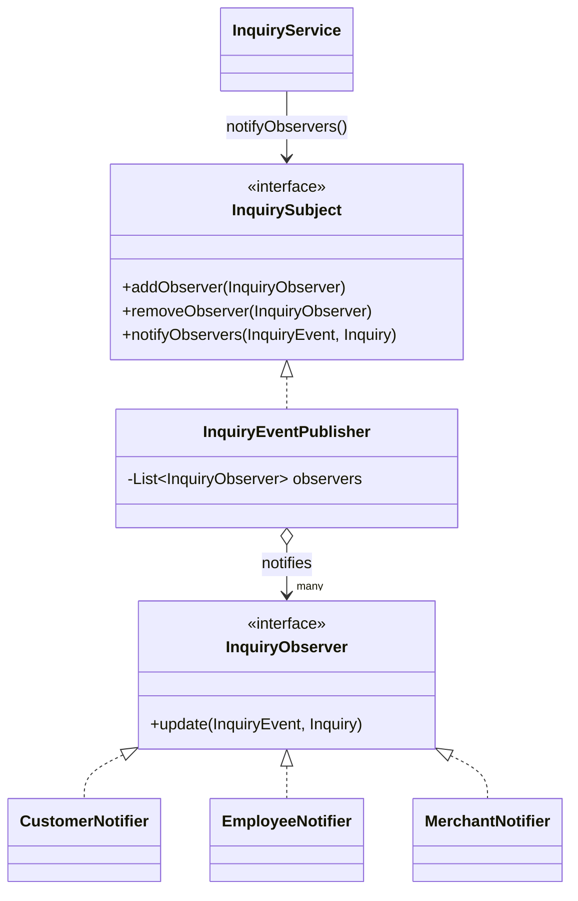

# Module 1 — Customer Support & Inquiries: **Observer Pattern**

> **Category:** Behavioral · **Lecture:** Part I, slides 29–43 (Tsunami Warning System example)
> **Package:** `src/main/java/com/sliit/se2030/mall/support/observer/`
> **Presented by:** ______________________

---

## 1. What the lecture says

**Definition (slide 30):**

> "Defines a one-to-many dependency between objects so that when one object
> changes state, all of its dependents are notified and updated automatically."

**Real-world example (slide 32):** social media — when a person posts, all of
their followers get a notification. Followers can follow/unfollow at any time.

**The four components (slide 33):**

| Component | Responsibility |
|---|---|
| **Subject** | Keeps a list of observers; methods to add/remove them; notifies them of changes. |
| **Observer** | Interface with an `update()` method, so every observer receives updates the same way. |
| **ConcreteSubject** | The actual subject holding the data; on a state change it notifies the registered observers. |
| **ConcreteObserver** | Implements the observer interface and reacts to the update. |

In the lecture's example, `TsunamiWarningSystem` is the concrete subject and
`MobileApp` and `NewsChannel` are concrete observers.

---

## 2. The problem in our system

An inquiry (help request) goes through many steps: a customer **submits** it,
the mall team **replies** or **forwards it to a shop**, the shop **replies**,
the team **resolves** it. At each step **different people need to be told**:

| Event | Customer | Mall team | Shop |
|---|---|---|---|
| `SUBMITTED` | ✔ "we received your request" | ✔ "a new request is waiting" | |
| `EMPLOYEE_REPLIED` | ✔ | | |
| `FORWARDED_TO_SHOP` | | | ✔ |
| `SHOP_REPLIED` | | ✔ "ready for your review" | |
| `RESOLVED` | ✔ | | |

**Without the pattern**, `InquiryService` would contain all of that notification
logic inline in every method — `if (event == …) notifyCustomer(); if (…) notifyShop();`
— mixing "manage inquiries" with "who to tell and how". Adding, say, an email
notifier would mean editing `InquiryService` in six places.

**With the pattern**, `InquiryService` just announces *what happened*. It does
not know who is listening.

---

## 3. Role mapping — lecture → our code

| Lecture role | Our class | What it does |
|---|---|---|
| **Subject** (interface) | `InquirySubject` | `addObserver`, `removeObserver`, `notifyObservers(event, inquiry)` |
| **Observer** (interface) | `InquiryObserver` | `update(InquiryEvent event, Inquiry inquiry)` |
| **ConcreteSubject** | `InquiryEventPublisher` | Holds the list of observers and loops over them |
| **ConcreteObserver** | `CustomerNotifier`, `EmployeeNotifier`, `MerchantNotifier` | Each decides which events matter to its audience |
| (the "state change") | `InquiryEvent` enum | `SUBMITTED`, `EMPLOYEE_REPLIED`, `FORWARDED_TO_SHOP`, `TAKEN_BACK_FROM_SHOP`, `SHOP_REPLIED`, `RESOLVED` |
| Client that triggers it | `InquiryService` | Calls `notifyObservers(...)` after each change |



---

## 4. Code walkthrough

### 4.1 The two interfaces — same shape as the lecture's (slides 35–36)

```java
public interface InquirySubject {
    void addObserver(InquiryObserver observer);
    void removeObserver(InquiryObserver observer);
    void notifyObservers(InquiryEvent event, Inquiry inquiry);
}

public interface InquiryObserver {
    void update(InquiryEvent event, Inquiry inquiry);
}
```

Difference from the lecture: the lecture's `update(String message)` passes a
plain string. Ours passes **what happened** (`InquiryEvent`) and **which
inquiry**, so each observer can build its own message for its own audience.

### 4.2 The concrete subject — `InquiryEventPublisher`

```java
@Component
public class InquiryEventPublisher implements InquirySubject {

    private final List<InquiryObserver> observers = new CopyOnWriteArrayList<>();

    public InquiryEventPublisher(List<InquiryObserver> observers) {
        this.observers.addAll(observers);          // Spring passes in every observer bean
    }

    public void addObserver(InquiryObserver observer)    { observers.add(observer); }
    public void removeObserver(InquiryObserver observer) { observers.remove(observer); }

    public void notifyObservers(InquiryEvent event, Inquiry inquiry) {
        for (InquiryObserver observer : observers) {
            try {
                observer.update(event, inquiry);
            } catch (RuntimeException e) {
                log.warn("Inquiry observer {} failed on {}", ..., event, e);
            }
        }
    }
}
```

Points worth explaining:

- **Same loop as the lecture's `TsunamiWarningSystem.notifyObservers()`** (slide 39).
- **Registration is automatic:** every class annotated `@Component` that
  implements `InquiryObserver` is found by Spring and passed into the
  constructor. `addObserver`/`removeObserver` still work at runtime
  ("follow / unfollow" from slide 32).
- **`CopyOnWriteArrayList`:** safe if an observer is added/removed while a
  notification loop is running.
- **`try/catch` per observer:** if one notifier fails, the others still run
  and the inquiry change itself is *not* rolled back. Notification is a side
  effect; it must never break the main action.

### 4.3 A concrete observer — `CustomerNotifier`

```java
@Component
public class CustomerNotifier implements InquiryObserver {
    @Override
    public void update(InquiryEvent event, Inquiry inquiry) {
        String message = switch (event) {
            case SUBMITTED        -> "we received your help request";
            case EMPLOYEE_REPLIED -> "the mall team replied to your help request";
            case RESOLVED         -> "your help request has been resolved";
            default -> null;   // shops' internal notes are not shown to customers
        };
        if (message != null) {
            log.info("[Notify customer {}] Inquiry #{} \"{}\": {}", ...);
        }
    }
}
```

`EmployeeNotifier` reacts to `SUBMITTED` and `SHOP_REPLIED`;
`MerchantNotifier` reacts only to `FORWARDED_TO_SHOP`. Each observer **filters
for the events its audience cares about**.

For now the "notification" is a log line. Changing it to an email or in-app
message would only change these classes, not `InquiryService`.

### 4.4 The client — `InquiryService`

Every method that changes an inquiry ends with one line:

```java
Inquiry saved = inquiryRepository.save(inquiry);
inquirySubject.notifyObservers(InquiryEvent.SUBMITTED, saved);       // submitInquiry()
...
inquirySubject.notifyObservers(InquiryEvent.EMPLOYEE_REPLIED, inquiry); // respondAsEmployee()
inquirySubject.notifyObservers(InquiryEvent.FORWARDED_TO_SHOP, inquiry); // forwardToMerchant()
inquirySubject.notifyObservers(InquiryEvent.TAKEN_BACK_FROM_SHOP, inquiry);
inquirySubject.notifyObservers(InquiryEvent.SHOP_REPLIED, inquiry);   // respondAsMerchant()
inquirySubject.notifyObservers(InquiryEvent.RESOLVED, inquiry);       // resolve()
```

Note that `InquiryService` depends on the **interface** `InquirySubject`, not on
the concrete publisher or any notifier — that is the loose coupling.

---

## 5. Runtime flow (what happens when a customer submits an inquiry)

1. Customer fills the form at `/inquiries/new` → `InquiryController` → `InquiryService.submitInquiry()`.
2. The inquiry is saved to the database.
3. `notifyObservers(SUBMITTED, inquiry)` is called on the publisher.
4. The publisher calls `update()` on **each** observer:
   - `CustomerNotifier` → logs "we received your help request"
   - `EmployeeNotifier` → logs "a new help request is waiting"
   - `MerchantNotifier` → ignores it (not forwarded yet)

---

## 6. How to demo it

1. Start the app and keep the **console / Run window visible** — the notifications appear there.
2. Log in as a customer (`cus2@mail.com` / `222222`), open `/inquiries/new` and submit one
   (an inquiry must be linked to one of your orders or a product — place an order first if the customer has none).
   → Console shows **two** lines: `[Notify customer ...]` and `[Notify mall team] ...`.
3. Log in as the employee (`admin@mall.local` / `admin123`), open `/employee/inquiries`, **forward** it to a shop.
   → Console: `[Notify shop <shop name>] ... was forwarded to your shop`.
4. Log in as that shop's merchant, reply at `/merchant/inquiries`.
   → Console: `[Notify mall team] ... a shop answered; ready for your review`.
5. As the employee, **resolve** it → Console: `[Notify customer ...] ... has been resolved`.

Point out: one action → several independent reactions, and `InquiryService`
never mentions customers/employees/shops when notifying.

---

## 7. Consequences — benefits and costs (slide 43, applied to us)

**Pros**
- *"Information can be transferred to multiple objects without changing the
  observer or subject classes."* → Adding an `EmailNotifier` = one new
  `@Component` class; no change to `InquiryService` or the publisher.
- *Loose coupling.* → `InquiryService` doesn't know who listens; notifiers
  don't know how inquiries are stored.

**Cons**
- *Can increase complexity / efficiency issues if done badly.* → Seven small
  classes instead of a few `log` lines; every observer is called for every
  event (each filters itself).
- *Observers are notified in an unspecified order.* → True here too: Spring's
  list order isn't guaranteed. That's fine for us because the notifiers are
  independent of each other.

---

## 8. Explaining it yourself — walkthrough script (no questions asked)

Use this if the examiner just says *"show us your design pattern"*. About 3 minutes.
Keep the IDE's **Run/console window visible** — that is where the notifications appear.

| # | Do | Say |
|---|---|---|
| 1 | Open `support/observer/` in the IDE | "My module is customer support. I used the **Observer pattern**, a **behavioral** pattern. It defines a one-to-many dependency: when one object changes, all its dependents are notified automatically." |
| 2 | — | "When an inquiry changes — submitted, forwarded, replied, resolved — different people must be told: the customer, the mall team or the shop. Without Observer, all that 'who to tell' logic would sit inside `InquiryService`, in every method." |
| 3 | Open `InquirySubject` and `InquiryObserver` | "These are the two interfaces from the lecture: the Subject with add, remove and notify, and the Observer with `update()`." |
| 4 | Open `InquiryEventPublisher` → `notifyObservers` | "This is the Concrete Subject. It keeps the list of observers and loops over them, like the lecture's Tsunami Warning System. Spring registers every observer automatically. Each call is in a try/catch so one failing notifier can't break the others." |
| 5 | Open `CustomerNotifier` (then mention the other two) | "These are the Concrete Observers. Each one decides which events matter to its audience — the customer isn't told about a shop's internal reply, and the shop is only told when an inquiry is forwarded to it." |
| 6 | Open `InquiryService.submitInquiry()` → the `notifyObservers` line | "The service only announces what happened. It doesn't know who is listening — that's the loose coupling." |
| 7 | Browser: submit an inquiry as `cus2`; point at the console | "One action, two reactions: the customer and the mall team were both notified. The shop wasn't, because it hasn't been forwarded yet." |
| 8 | Browser: as admin, forward it to a shop; point at the console | "Now only the shop's notifier reacted." |
| 9 | — | "Benefit: to add email notifications I write one new observer class; nothing else changes. Cost from the slides: more classes, and observers are notified in no guaranteed order — fine here, because they're independent." |

---

## 9. Viva questions & answers

**Q: Which class is the Subject and which are the Observers?**
A: `InquirySubject` is the subject interface and `InquiryEventPublisher` is the
concrete subject. `InquiryObserver` is the observer interface; `CustomerNotifier`,
`EmployeeNotifier` and `MerchantNotifier` are the concrete observers.

**Q: How do the observers get registered? I don't see `addObserver()` being called.**
A: Spring does it. Every `@Component` implementing `InquiryObserver` is
collected into a `List` and passed to the publisher's constructor, which adds
them all. `addObserver()`/`removeObserver()` are still available for runtime changes.

**Q: How would you add email notifications?**
A: Write `EmailNotifier implements InquiryObserver`, annotate it `@Component`,
send the email inside `update()`. No existing class changes — Open/Closed Principle.

**Q: What happens if one observer throws an exception?**
A: The publisher catches it per observer, logs a warning and continues with the
others. The inquiry has already been saved, so a failed notification never
undoes the customer's request.

**Q: Why pass an `InquiryEvent` instead of a message string like the lecture?**
A: Different audiences need different messages (a customer shouldn't see "a
shop replied" — that note is internal). Passing the event lets each observer
decide whether it cares and what to say.

**Q: Is this "push" or "pull" Observer?**
A: Push — the subject pushes the event and the inquiry to the observers in
`update()`, so observers don't have to query the subject.

**Q: How is this different from just calling three methods in a row?**
A: Calling three methods hard-codes *who* is notified into `InquiryService`.
With Observer, the subject only knows the `InquiryObserver` interface; the set
of listeners can grow or change without touching it.
