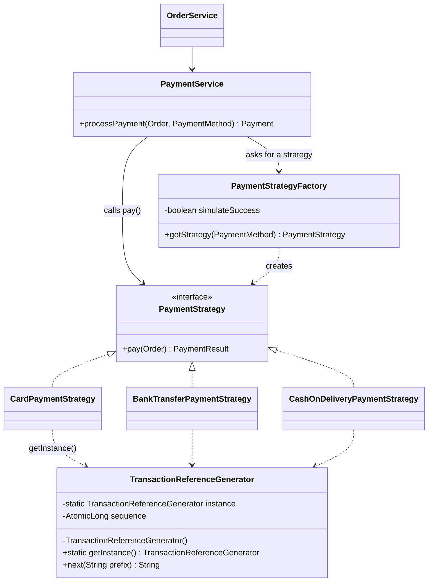

# Module 2 — Order & Payment Handling: **Strategy + Factory + Singleton**

> **Categories:** Strategy = Behavioral · Factory = Creational · Singleton = Creational
> **Lectures:** Strategy — Part II, slides 2–24 (*E-commerce Payment* example) ·
> Factory — Part II, slides 25–36 · Singleton — Part I, slides 14–28
> **Package:** `src/main/java/com/sliit/se2030/mall/order/payment/`
> **Presented by:** ______________________

This module is the strongest one to present: the Strategy part is **the exact
example from the lecture** (Credit Card / PayPal / Bank Transfer at checkout),
and it shows three patterns cooperating.

---

## 1. What the lectures say

### Strategy (Part II, slides 3–8)

> "Defines a family of algorithms, encapsulates each one, and makes them
> interchangeable. Strategy lets the algorithm vary independently from clients
> that use it."

1. **Family of algorithms** — several ways to do the same job (here: *pay for an order*).
2. **Encapsulate each one** — each in its own class, instead of a big `if/else`.
3. **Interchangeable** — all implement one interface, so they can be swapped at runtime.

**Components (slides 15–20):**

| Component | Lecture's example |
|---|---|
| **Context** | `ShoppingCart` — holds a reference to a `PaymentStrategy` and uses it at checkout |
| **Strategy** | `PaymentStrategy` interface — declares `pay(int amount)` |
| **Concrete Strategies** | `CreditCardPayment`, `PayPalPayment`, `BankTransferPayment` |
| **Client** | Code that selects which strategy to apply |

**The problem it solves (slides 12–13):** *"Payment logic tied up in long
if–else chains. Hard to extend, tightly coupled, and violates good OOP principles."*

### Factory (Part II, slides 26–33)

> "Defines an interface for creating objects. Subclasses/factory decide which
> class to instantiate. Client code depends only on factory + interface, not on
> concrete classes."

Steps from the lecture's *Vehicle* example: (1) common interface `Vehicle`,
(2) concrete classes `Car`, `Bike`, `Truck`, (3) a factory class, (4) the client
asks the factory instead of using `new`.

### Singleton (Part I, slides 15–23)

> "Ensure that a class has only one instance and provide a global access point to it."

Three steps: **(1) private constructor**, **(2) private static instance
variable**, **(3) public static `getInstance()`** that creates the object on the
first call and returns the same one afterwards.

---

## 2. The problem in our system

At checkout the customer chooses how to pay: **card**, **bank transfer** or
**cash on delivery**. Each method behaves differently:

| Method | Behaviour (simulated — no real money) | Reference prefix |
|---|---|---|
| Card | Approved, *or* declined if declines are switched on | `CARD-` |
| Bank transfer | Confirmed, *or* declined if declines are switched on | `BANK-` |
| Cash on delivery | **Always** accepted — nothing to decline at checkout | `COD-` |

**Without patterns**, `PaymentService` would look like:

```java
if (method == CARD) { ...card logic... }
else if (method == BANK_TRANSFER) { ...bank logic... }
else if (method == CASH_ON_DELIVERY) { ...cod logic... }
```

— exactly the "long if–else chain" the lecture warns about. Every new method
(e.g. a mobile wallet) would mean editing this method.

We also need every payment to get a **unique transaction reference** (the
`payments` table has a `UNIQUE` constraint), shared across all methods.

---

## 3. Role mapping — lecture → our code

### Strategy

| Lecture role | Our class |
|---|---|
| **Strategy** interface | `PaymentStrategy` — `PaymentResult pay(Order order)` |
| **Concrete Strategies** | `CardPaymentStrategy`, `BankTransferPaymentStrategy`, `CashOnDeliveryPaymentStrategy` |
| **Context** | `PaymentService` (in `order/service`) |
| **Client** (chooses) | The customer, through the radio buttons on `checkout.jsp` → `CheckoutForm.paymentMethod` |

### Factory

| Lecture role | Our class |
|---|---|
| Product interface (`Vehicle`) | `PaymentStrategy` |
| Concrete products (`Car`, `Bike`, `Truck`) | the three payment strategies |
| **Factory** (`VehicleFactory`) | `PaymentStrategyFactory` — `getStrategy(PaymentMethod)` |
| "type" parameter | `PaymentMethod` enum: `CARD`, `BANK_TRANSFER`, `CASH_ON_DELIVERY` |

### Singleton

| Lecture element | Our code |
|---|---|
| `private static Singleton instance;` | `private static TransactionReferenceGenerator instance;` |
| `private Singleton() {}` | `private TransactionReferenceGenerator() {}` |
| `public static Singleton getInstance()` | `public static synchronized TransactionReferenceGenerator getInstance()` |



---

## 4. Code walkthrough

### 4.1 Strategy interface

```java
public interface PaymentStrategy {
    PaymentResult pay(Order order);
}
```

Same idea as the lecture's `pay(int amount)`, but we pass the whole `Order`
(it carries the amount) and return a `PaymentResult` (status, method name,
transaction reference) instead of printing.

### 4.2 A concrete strategy

```java
public class CardPaymentStrategy implements PaymentStrategy {

    private final boolean simulateSuccess;

    public CardPaymentStrategy(boolean simulateSuccess) { this.simulateSuccess = simulateSuccess; }

    @Override
    public PaymentResult pay(Order order) {
        String reference = TransactionReferenceGenerator.getInstance().next("CARD");
        PaymentStatus status = simulateSuccess ? PaymentStatus.SIMULATED_SUCCESS : PaymentStatus.SIMULATED_FAILED;
        return new PaymentResult(status, PaymentMethod.CARD.name(), reference);
    }
}
```

`BankTransferPaymentStrategy` is the same shape with `"BANK"`.
`CashOnDeliveryPaymentStrategy` **always** returns `SIMULATED_SUCCESS` — that
difference in behaviour is the whole reason they are separate strategies.

### 4.3 The factory — the only place with a `switch`

```java
@Component
public class PaymentStrategyFactory {

    private final boolean simulateSuccess;

    public PaymentStrategyFactory(@Value("${mall.payment.dummy.always-succeed:true}") boolean simulateSuccess) {
        this.simulateSuccess = simulateSuccess;
    }

    public PaymentStrategy getStrategy(PaymentMethod method) {
        if (method == null) {
            throw new IllegalArgumentException("A payment method is required.");
        }
        return switch (method) {
            case CARD             -> new CardPaymentStrategy(simulateSuccess);
            case BANK_TRANSFER    -> new BankTransferPaymentStrategy(simulateSuccess);
            case CASH_ON_DELIVERY -> new CashOnDeliveryPaymentStrategy();
        };
    }
}
```

This is the lecture's `VehicleFactory` shape: give it a type, get back an object
typed as the **interface**. It also hides a creation detail — the
`simulateSuccess` setting from `application.properties` — from everyone else.

### 4.4 The context — `PaymentService`

```java
public Payment processPayment(Order order, PaymentMethod method) {
    PaymentStrategy strategy = paymentStrategyFactory.getStrategy(method);   // Factory
    PaymentResult result = strategy.pay(order);                              // Strategy
    Payment payment = new Payment(order, result.status(), result.paymentMethod(), result.transactionRef());
    return paymentRepository.save(payment);
}
```

No `if` on the payment method anywhere. `PaymentService` only knows the
`PaymentStrategy` interface.

### 4.5 The Singleton — `TransactionReferenceGenerator`

```java
public final class TransactionReferenceGenerator {

    private static TransactionReferenceGenerator instance;          // step 2
    private final AtomicLong sequence = new AtomicLong();

    private TransactionReferenceGenerator() { }                     // step 1

    public static synchronized TransactionReferenceGenerator getInstance() {   // step 3
        if (instance == null) {
            instance = new TransactionReferenceGenerator();
        }
        return instance;
    }

    public String next(String prefix) {          // e.g. "BANK-1791694398523-1"
        return prefix + "-" + System.currentTimeMillis() + "-" + sequence.incrementAndGet();
    }
}
```

- Identical to the lecture's three steps (slides 18–23), with `synchronized`
  added — the lecture's "Thread Safety: can be implemented to ensure safe
  concurrent access" (slide 28). Two customers checking out at the same moment
  must not both see `instance == null` and create two generators.
- **Why one instance matters here:** all three strategies share **one counter**,
  so even two payments in the same millisecond get different references. The
  timestamp keeps references unique after a restart (when the counter restarts at 1).
- `final` class: it can't be subclassed to get around the private constructor.

### 4.6 Where it's triggered

- `checkout.jsp` shows a radio button per `PaymentMethod` (labels from `PaymentMethod.getLabel()`).
- `CheckoutForm.paymentMethod` receives the choice (defaults to `CARD`, `@NotNull`).
- `OrderService.checkout()` → `paymentService.processPayment(order, form.getPaymentMethod())`.
- If the result isn't `SIMULATED_SUCCESS`, `checkout()` throws and the whole
  checkout transaction **rolls back** (stock and cart are restored).

---

## 5. Runtime flow (customer pays by bank transfer)

1. Customer picks **Bank transfer** and clicks *Place order*.
2. `OrderService.checkout()` saves the order and its items, then calls `processPayment(order, BANK_TRANSFER)`.
3. **Factory:** `getStrategy(BANK_TRANSFER)` → `new BankTransferPaymentStrategy(...)`.
4. **Strategy:** `strategy.pay(order)`.
5. **Singleton:** inside `pay()`, `TransactionReferenceGenerator.getInstance().next("BANK")` → `BANK-1791694398523-1`.
6. The `Payment` row is saved with method `BANK_TRANSFER` and that reference.

---

## 6. How to demo it

1. Log in as `cus2@mail.com` / `222222`, add something to the cart, open **Checkout**.
2. Show the three **Payment** radio buttons → place the order with **Bank transfer**.
3. Show the result in MySQL:
   ```sql
   SELECT order_id, payment_method, status, transaction_ref FROM payments ORDER BY id DESC LIMIT 3;
   ```
   → `BANK_TRANSFER | SIMULATED_SUCCESS | BANK-...`
4. **Swapping behaviour without code changes:** set
   `mall.payment.dummy.always-succeed=false` in `application.properties`, restart:
   - Card or bank transfer → *"Payment was declined…"* and the cart is untouched.
   - Cash on delivery → still succeeds. Same context, different strategy, different behaviour.
5. Show the tests: `PaymentStrategyFactoryTest` (factory returns the right class,
   COD succeeds when others decline, `getInstance()` returns the same object).

---

## 7. Consequences — benefits and costs

### Strategy (slides 23–24)

| Lecture point | In our system |
|---|---|
| ✔ Eliminates long if–else / switch | `PaymentService` has none |
| ✔ Easy to extend (Open/Closed) | New wallet payment = one new class + one `case` in the factory |
| ✔ Runtime flexibility | The customer picks the algorithm per order |
| ✔ Single Responsibility | Each class knows only its own payment method |
| ✘ More classes to manage | 3 strategies + interface + enum + result record |
| ✘ Client awareness needed | Someone must pick — here the customer + the factory |

### Factory (slides 35–36)

| Lecture point | In our system |
|---|---|
| ✔ Hides creation details | `simulateSuccess` setting is wired in only by the factory |
| ✔ Loose coupling | `PaymentService` never mentions a concrete strategy class |
| ✘ Extra class / slightly more complex | One extra class for three `new` calls |

### Singleton (slide 28)

| Lecture point | In our system |
|---|---|
| ✔ Global access, one shared state | One shared counter for every payment |
| ✔ Thread safety can be added | `synchronized getInstance()` + `AtomicLong` |
| ✘ Harder to test (shared global state) | The counter carries over between tests — we only assert references *differ* |
| ✘ Tight coupling | Strategies call `getInstance()` directly; acceptable for a tiny utility |

---

## 8. Explaining it yourself — walkthrough script (no questions asked)

Use this if the examiner just says *"show us your design pattern"*. About 4 minutes —
three patterns, so keep each step short. Have the checkout page and MySQL ready.

| # | Do | Say |
|---|---|---|
| 1 | Browser: open **Checkout**, point at the three payment options | "My module is order and payment. The customer can pay by card, bank transfer or cash on delivery. This is the exact situation from the Strategy lecture's e-commerce payment example." |
| 2 | — | "Each method behaves differently — cash on delivery can never be declined at checkout. Without a pattern, `PaymentService` would be one long if–else on the method, which the lecture says is hard to extend and tightly coupled." |
| 3 | Open `PaymentStrategy` | "**Strategy pattern** — behavioral. This is the Strategy interface: every payment method has a `pay()` method." |
| 4 | Open `CardPaymentStrategy`, then `CashOnDeliveryPaymentStrategy` | "These are the Concrete Strategies, one class per method. Card can be declined; cash on delivery always succeeds." |
| 5 | Open `PaymentService.processPayment()` | "This is the Context. It has no if–else on the method: it gets a strategy and calls `pay()`." |
| 6 | Open `PaymentStrategyFactory.getStrategy()` | "Where does the strategy come from? The **Factory pattern** — creational. Like the lecture's `VehicleFactory`, I give it a `PaymentMethod` and it returns the right object, typed as the interface. This `switch` is the only place that knows the concrete classes." |
| 7 | Open `TransactionReferenceGenerator` | "Every payment needs a unique reference, and all strategies must share one counter. That's the **Singleton pattern**: private constructor, private static instance, public static `getInstance()` — the lecture's three steps — plus `synchronized`, so two checkouts at once can't create two instances." |
| 8 | Browser: place an order with **Bank transfer**; run the `SELECT … FROM payments` query | "The payment was stored with method `BANK_TRANSFER` and a reference from the singleton, `BANK-…`." |
| 9 | Show `mall.payment.dummy.always-succeed` in `application.properties` | "If I set this to false, card and bank transfer are declined and the whole checkout rolls back, but cash on delivery still succeeds — same context, different strategy, different behaviour." |
| 10 | Run `PaymentStrategyFactoryTest` | "These tests check the factory returns the right class, COD succeeds when the others decline, and `getInstance()` always returns the same object." |
| 11 | — | "Benefit: a new method such as a mobile wallet is one new strategy class and one `case` in the factory — Open/Closed. Cost: more classes, and someone has to choose the strategy — here the customer, through the factory." |

---

## 9. Viva questions & answers

**Q: Which class is the Context?**
A: `PaymentService`. It holds no payment logic itself; it gets a
`PaymentStrategy` from the factory and calls `pay()`.

**Q: Where does the "choose a strategy" decision happen?**
A: The customer chooses on the checkout page; the factory turns that
`PaymentMethod` into the right strategy object. That's the only `switch`.

**Q: How would you add a new payment method, e.g. "Mobile wallet"?**
A: (1) add `MOBILE_WALLET("Mobile wallet")` to `PaymentMethod`,
(2) write `MobileWalletPaymentStrategy implements PaymentStrategy`,
(3) add one `case` in `PaymentStrategyFactory`. The checkout page shows the new
radio button automatically (it loops over `PaymentMethod.values()`).
`PaymentService` and `OrderService` don't change.

**Q: Why do you need both Strategy and Factory? Isn't one enough?**
A: They solve different problems. Strategy separates *how each method pays*.
Factory centralises *which strategy object to create* so the context doesn't
contain `new CardPaymentStrategy(...)` choices. Without the factory, the
`switch` would just move into `PaymentService`.

**Q: Spring already makes beans singletons. Why write a Singleton by hand?**
A: The strategies are plain objects created with `new` by the factory, not
Spring beans, so they can't have a Spring bean injected. A hand-written
Singleton gives them one shared generator. It also shows the lecture's pattern
exactly: private constructor, static instance, static `getInstance()`.

**Q: Why is `getInstance()` `synchronized`?**
A: Without it, two threads (two simultaneous checkouts) could both see
`instance == null` and each create one, breaking the "only one instance" rule.

**Q: Is the reference really unique? What after a restart?**
A: Within a run, the shared `AtomicLong` counter guarantees uniqueness. After a
restart the counter starts at 1 again, but the millisecond timestamp has moved
on, so the combination is still unique.

**Q: Is this real payment processing?**
A: No — project scope says payments are simulated (`PaymentStatus.SIMULATED_*`).
The structure is what a real system would use: replacing a simulated strategy
with one that calls a real gateway would only change that one class.

**Q: What happens if payment fails?**
A: `OrderService.checkout()` throws a `BusinessRuleViolationException`; because
the method is `@Transactional`, the order, the stock deduction and the cart
clearing are all rolled back.
