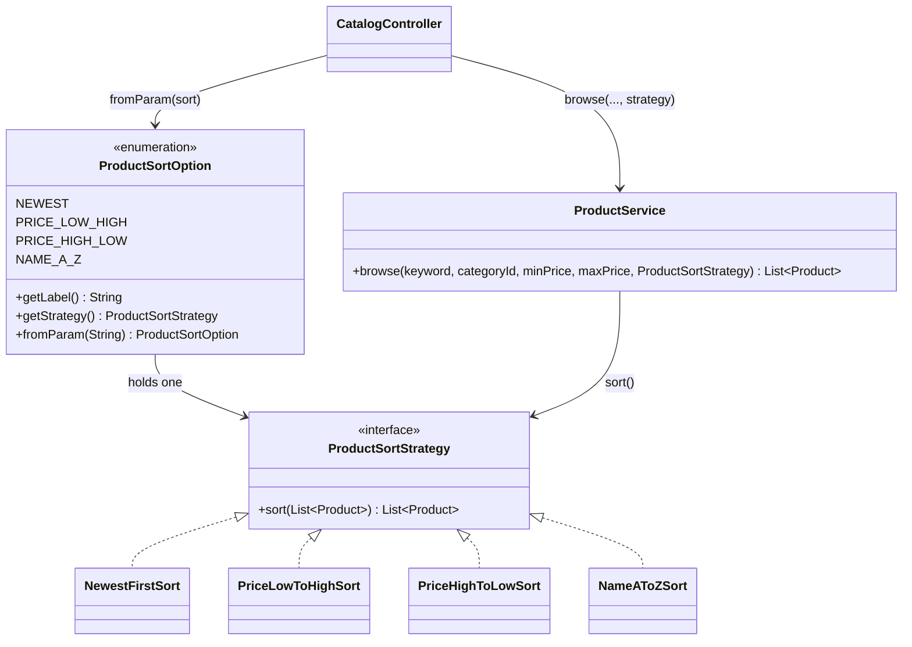

# Module 3 — Product Catalogue: **Strategy Pattern (sorting)**

> **Category:** Behavioral · **Lecture:** Part II, slides 2–24 (*Sorting Algorithms* example, slides 6–9)
> **Package:** `src/main/java/com/sliit/se2030/mall/catalog/sort/`
> **Presented by:** ______________________

---

## 1. What the lecture says

**Definition (slide 3):**

> "Defines a family of algorithms, encapsulates each one, and makes them
> interchangeable. Allows algorithms to vary independently from the clients
> that use them."

The lecture explains it **using sorting** (slides 5–9):

1. **Defines a family of algorithms** — "Sorting a list. You could use Bubble
   Sort, Quick Sort, Merge Sort. All of these are different algorithms for the
   same task."
2. **Encapsulates each one** — "Instead of writing big if-else code, each
   sorting method is written in its own class."
3. **Makes them interchangeable** — "Each algorithm follows a common interface
   (e.g. SortStrategy), so we can swap one with another at runtime without
   changing the main code."

**UML roles (slide 9):** **Context** uses a Strategy object · **Strategy
interface** defines the method · **Concrete Strategies** implement it.

Slide 22 lists *"Sorting Algorithms"* as a practical use.

---

## 2. The problem in our system

Shoppers browsing `/catalog` want to order the results in different ways:

- Newest first
- Price: low to high
- Price: high to low
- Name: A to Z

**Without the pattern**, `ProductService.browse()` would end with:

```java
if ("PRICE_LOW_HIGH".equals(sort)) { list.sort(...price ascending...); }
else if ("PRICE_HIGH_LOW".equals(sort)) { list.sort(...price descending...); }
else if ("NAME_A_Z".equals(sort)) { ... }
else { ...newest... }
```

Filtering (keyword, category, price range) and ordering would be mixed in one
method, and every new sort order would mean editing it.

Our variation on the lecture: the lecture's family is *different algorithms
producing the same order* (bubble vs quick sort). Ours is *different orderings*
— but it is the same structure: a family of interchangeable "sort the list"
behaviours behind one interface.

---

## 3. Role mapping — lecture → our code

| Lecture role | Our class | Notes |
|---|---|---|
| **Strategy** interface (`SortStrategy`) | `ProductSortStrategy` | `List<Product> sort(List<Product> products)` |
| **Concrete Strategies** (`BubbleSort`, `QuickSort`, …) | `NewestFirstSort`, `PriceLowToHighSort`, `PriceHighToLowSort`, `NameAToZSort` | One ordering each |
| **Context** | `ProductService.browse(…, ProductSortStrategy sortStrategy)` | Filters, then delegates ordering |
| **Client** (selects the strategy) | `CatalogController` (from the `?sort=` value) and `HomeController` (always newest) | |
| (helper) | `ProductSortOption` enum | Pairs each dropdown choice with its strategy and label |



---

## 4. Code walkthrough

### 4.1 Strategy interface

```java
public interface ProductSortStrategy {
    // Returns a new sorted list; the list passed in is left as it is.
    List<Product> sort(List<Product> products);
}
```

### 4.2 Concrete strategies — each one is tiny and does one thing

```java
public class PriceLowToHighSort implements ProductSortStrategy {
    @Override
    public List<Product> sort(List<Product> products) {
        return products.stream()
                .sorted(Comparator.comparing(Product::getPrice)
                        .thenComparing(Product::getName, String.CASE_INSENSITIVE_ORDER))
                .toList();
    }
}
```

| Class | Ordering | Tie-breaker |
|---|---|---|
| `NewestFirstSort` | `createdAt` descending | id descending |
| `PriceLowToHighSort` | price ascending | name A–Z |
| `PriceHighToLowSort` | price descending | name A–Z |
| `NameAToZSort` | name, ignoring upper/lower case | — |

Tie-breakers keep the order stable (two products at the same price always
appear in the same order).

### 4.3 `ProductSortOption` — connecting the dropdown to the strategies

```java
public enum ProductSortOption {
    NEWEST("Newest first", new NewestFirstSort()),
    PRICE_LOW_HIGH("Price: low to high", new PriceLowToHighSort()),
    PRICE_HIGH_LOW("Price: high to low", new PriceHighToLowSort()),
    NAME_A_Z("Name: A to Z", new NameAToZSort());

    ...
    // A missing or unknown ?sort= value (e.g. an old bookmark) falls back to NEWEST.
    public static ProductSortOption fromParam(String value) { ... }
}
```

Each enum constant **holds one strategy object**. The strategies have no state,
so one shared instance of each is enough.

### 4.4 The context — `ProductService.browse()`

```java
public List<Product> browse(String keyword, Long categoryId, BigDecimal minPrice, BigDecimal maxPrice,
                            ProductSortStrategy sortStrategy) {
    List<Product> matches = productRepository.findByActiveTrue().stream()
            .filter(Product::isOnSale)
            .filter(...keyword...)
            .filter(...category...)
            .filter(...min/max price...)
            .toList();
    return sortStrategy.sort(matches);     // <- delegates the "how to order" decision
}
```

`browse()` knows **nothing** about prices or names for ordering — it only knows
the `ProductSortStrategy` interface.

### 4.5 The clients

```java
// CatalogController — the shopper's choice
ProductSortOption sortOption = ProductSortOption.fromParam(sort);   // ?sort=PRICE_LOW_HIGH
model.addAttribute("products",
        productService.browse(keyword, categoryId, minPrice, maxPrice, sortOption.getStrategy()));

// HomeController — the landing page always wants newest first
productService.browse(null, null, null, null, ProductSortOption.NEWEST.getStrategy());
```

Two different clients, same context, different strategies — interchangeability in action.

`browse.jsp` builds the **Sort by** dropdown by looping over
`ProductSortOption.values()`, so a new option appears automatically.

---

## 5. Runtime flow

1. Shopper chooses *Price: low to high* and clicks **Show products** → `GET /catalog?sort=PRICE_LOW_HIGH`.
2. `CatalogController`: `fromParam("PRICE_LOW_HIGH")` → `PRICE_LOW_HIGH` → its `PriceLowToHighSort`.
3. `ProductService.browse(..., priceLowToHighSort)` filters the products, then calls `sort()`.
4. The JSP shows the list cheapest first, with *Price: low to high* still selected.

---

## 6. How to demo it

1. Open `/catalog` (no login needed). Default is **Newest first**.
2. In the filter panel, change **Sort by** to *Price: low to high* → **Show products**. Cheapest items first (Rs. 19.99, 300, 400…).
3. Switch to *Price: high to low* → most expensive first (Rs. 2,700,000…).
4. Switch to *Name: A to Z* (Amazon Echo Plus, American Football, …).
5. Combine with a filter (e.g. a floor/category + price range) — the strategy only orders whatever the filters returned.
6. Type `?sort=nonsense` in the URL → falls back to *Newest first*, no error page.
7. Show `ProductSortStrategyTest`.

---

## 7. Consequences (slides 23–24, applied to us)

**Advantages**
- *Eliminates long if–else.* → `browse()` has a single `sortStrategy.sort(matches)` line.
- *Easy to extend / Open-Closed.* → New "Top rated" order = one new class + one enum constant.
- *Runtime flexibility.* → The shopper switches order per request.
- *Single Responsibility.* → Filtering stays in `ProductService`; ordering lives in the strategy classes.
- *Reusability.* → `HomeController` reuses the same `NewestFirstSort`.

**Disadvantages**
- *More classes to manage.* → Five classes + an enum for four orderings.
- *Client awareness needed.* → The controller must turn the URL value into a strategy (handled by `fromParam`).
- *Overhead for small problems.* → Each strategy is only a few lines; a single comparator map could also work — but then adding behaviour beyond a comparator (e.g. "featured first, then by rating") would be harder.

---

## 8. Explaining it yourself — walkthrough script (no questions asked)

Use this if the examiner just says *"show us your design pattern"*. About 3 minutes.

| # | Do | Say |
|---|---|---|
| 1 | Browser: `/catalog`, open the **Sort by** dropdown | "My module is the product catalogue. Shoppers can sort by newest, price low-to-high, high-to-low, or name. I used the **Strategy pattern**, a **behavioral** pattern — the lecture itself explains it with sorting algorithms." |
| 2 | — | "Without it, `browse()` would end in an if–else for every sort order, mixed in with the filtering. Every new order would mean editing that method." |
| 3 | Open `ProductSortStrategy` | "This is the Strategy interface: one `sort()` method that takes the product list and returns it in order." |
| 4 | Open `PriceLowToHighSort` (mention the other three) | "These are the Concrete Strategies — each ordering is its own small class, like the lecture's BubbleSort and QuickSort classes." |
| 5 | Open `ProductService.browse()` → last line | "This is the Context. It filters by keyword, floor and price, then hands the list to whatever strategy it was given. It doesn't know how the list gets ordered." |
| 6 | Open `CatalogController.browse()` and `ProductSortOption` | "The controller is the client: it turns the `?sort=` value into a strategy using this enum. An unknown value falls back to newest instead of an error page." |
| 7 | Open `HomeController` | "Another client, the home page, always passes the newest-first strategy. Same context, different strategy — that's interchangeability." |
| 8 | Browser: switch between the sort options | "Here it is running — the context code is the same every time; only the strategy changes." |
| 9 | Run `ProductSortStrategyTest` | "The tests check each ordering and the fallback." |
| 10 | — | "Benefit: 'Top rated' would be one new class and one enum line. Cost from the slides: more classes for a small job." |

---

## 9. Viva questions & answers

**Q: Which is the Context here?**
A: `ProductService.browse()` — it receives a `ProductSortStrategy` and calls
`sort()` on it without knowing which one it is.

**Q: How do you add "Top rated first"?**
A: Write `TopRatedSort implements ProductSortStrategy`, then add
`TOP_RATED("Top rated", new TopRatedSort())` to `ProductSortOption`. The
dropdown shows it automatically; `ProductService` and the controller don't change.

**Q: The lecture's sort strategies (bubble/quick/merge) give the *same* result. Yours give different results. Is it still Strategy?**
A: Yes. The pattern is about a family of interchangeable algorithms for the
same task behind a common interface — here, the task is "put this product list
in order". Which algorithm you pick changes the behaviour; the context doesn't change.

**Q: Why does the enum hold strategy objects — isn't that a Factory?**
A: It's a simple lookup table so the controller can turn `?sort=` into a
strategy. The strategies have no state, so each is created once when the enum
loads; nothing new is created per request. The pattern being demonstrated is
Strategy.

**Q: What happens with an invalid `?sort=` value?**
A: `fromParam()` falls back to `NEWEST`, so an old bookmark or a typed-in URL
never causes an error page.

**Q: Why sort in Java instead of SQL `ORDER BY`?**
A: Filtering is already done in Java (see the comment in `ProductService`) at
this project's scale; keeping ordering in Java lets each strategy be a small,
testable class. For a very large catalogue we'd push sorting into the database query.
