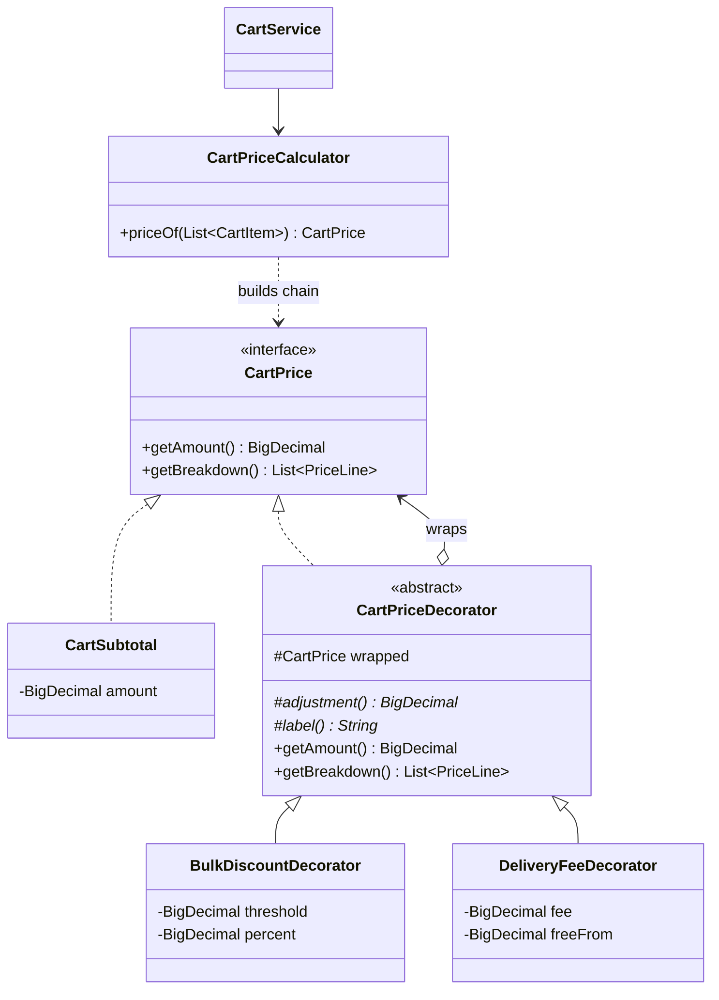

# Module 4 — Shopping Cart: **Decorator Pattern**

> **Category:** Structural · **Lecture:** Part II, slides 37–49 (*Online Coffee Ordering* example — "Self Study")
> **Package:** `src/main/java/com/sliit/se2030/mall/cart/pricing/`
> **Presented by:** ______________________

---

## 1. What the lecture says

**What is Decorator? (slide 38)**

- A **structural** design pattern.
- **Attaches new behaviour to objects dynamically at runtime.**
- Works by **wrapping** the original object with a decorator object.
- Provides flexibility **without modifying the original class**.

**The coffee example (slides 40–46):** a customer orders a basic coffee and
adds Milk, Sugar, … With inheritance you would need `MilkCoffee`,
`SugarCoffee`, `MilkSugarCoffee`, `MilkSugarCreamCoffee`, … ("subclass
explosion"). Instead:

```text
SimpleCoffee  →  wrapped by MilkDecorator  →  wrapped by SugarDecorator
```

| Lecture role | Coffee example |
|---|---|
| **Component** (interface) | `Coffee` — `getDescription()`, `getCost()` |
| **Concrete Component** | `SimpleCoffee` — cost 2.0 |
| **Abstract Decorator** | `CoffeeDecorator` — holds `protected Coffee decoratedCoffee`, passes calls through |
| **Concrete Decorators** | `MilkDecorator` (+0.5, ", Milk"), `SugarDecorator` (+0.2, ", Sugar") |

Each decorator returns `decoratedCoffee.getCost() + its own amount`, and
`decoratedCoffee.getDescription() + its own text`.

---

## 2. The problem in our system

The cart's price is no longer just *price × quantity*. It is built up in layers:

1. **Subtotal** — sum of price × quantity for every item.
2. **Bulk discount** — 5% off when the subtotal is Rs. 50,000 or more.
3. **Delivery fee** — Rs. 350, **free** when the (discounted) amount is Rs. 10,000 or more; no fee for an empty cart.

The cart and checkout pages must show **each layer as a line**, not just the total:

```text
Subtotal            Rs. 2,700,000.00
Discount (5% off) − Rs.   135,000.00
Delivery (free)                 Free
Total               Rs. 2,565,000.00
```

**Without the pattern** you would either:
- put every rule into one growing `calculateTotal()` method full of `if`s, or
- (the lecture's warning) create classes for each combination —
  `SubtotalWithDelivery`, `SubtotalWithDiscount`, `SubtotalWithDiscountAndDelivery`, … — which explodes as rules are added (gift wrapping, tax, vouchers…).

This is **the coffee problem with money**: a base item plus optional add-ons
that each change the cost *and* the description.

---

## 3. Role mapping — lecture → our code

| Lecture role | Coffee example | Our class |
|---|---|---|
| **Component** | `Coffee` | `CartPrice` — `getAmount()`, `getBreakdown()` |
| `getCost()` | | `getAmount()` |
| `getDescription()` | | `getBreakdown()` — list of `PriceLine(label, amount)` |
| **Concrete Component** | `SimpleCoffee` | `CartSubtotal` |
| **Abstract Decorator** | `CoffeeDecorator` | `CartPriceDecorator` (`protected final CartPrice wrapped`) |
| **Concrete Decorators** | `MilkDecorator`, `SugarDecorator` | `BulkDiscountDecorator`, `DeliveryFeeDecorator` |
| **Client** (`Main`) | wraps the coffee | `CartPriceCalculator` — builds the chain |



The key arrow: `CartPriceDecorator` **is a** `CartPrice` *and* **has a**
`CartPrice`. That is what lets decorators wrap each other in any order.

---

## 4. Code walkthrough

### 4.1 Component

```java
public interface CartPrice {
    BigDecimal getAmount();
    List<PriceLine> getBreakdown();
}

public record PriceLine(String label, BigDecimal amount) { ... }   // discounts are negative
```

### 4.2 Concrete component — like `SimpleCoffee`

```java
public class CartSubtotal implements CartPrice {

    private final BigDecimal amount;

    public CartSubtotal(List<CartItem> items) {
        this.amount = items.stream()
                .map(item -> item.getProduct().getPrice().multiply(BigDecimal.valueOf(item.getQuantity())))
                .reduce(BigDecimal.ZERO, BigDecimal::add);
    }

    public BigDecimal getAmount()         { return amount; }
    public List<PriceLine> getBreakdown() { return List.of(new PriceLine("Subtotal", amount)); }
}
```

### 4.3 Abstract decorator — like `CoffeeDecorator`

```java
public abstract class CartPriceDecorator implements CartPrice {

    protected final CartPrice wrapped;                 // = decoratedCoffee

    protected CartPriceDecorator(CartPrice wrapped) { this.wrapped = wrapped; }

    protected abstract BigDecimal adjustment();        // +fee, -discount, or 0
    protected abstract String label();                 // null = no line to show

    @Override
    public BigDecimal getAmount() {
        return wrapped.getAmount().add(adjustment());  // = decoratedCoffee.getCost() + 0.5
    }

    @Override
    public List<PriceLine> getBreakdown() {
        List<PriceLine> lines = new ArrayList<>(wrapped.getBreakdown());   // = description + ", Milk"
        String label = label();
        if (label != null) {
            lines.add(new PriceLine(label, adjustment()));
        }
        return lines;
    }
}
```

Small improvement over the lecture: in the coffee example every concrete
decorator repeats `decoratedCoffee.getCost() + x`. Here the abstract decorator
does the wrapping once, and each concrete decorator only says **how much** and
**what to call it**. (This combines Decorator with a "template method" — fine
to mention if asked.)

### 4.4 Concrete decorators — like `MilkDecorator` / `SugarDecorator`

```java
public class BulkDiscountDecorator extends CartPriceDecorator {
    ...
    private boolean applies() {
        return percent.signum() > 0 && wrapped.getAmount().compareTo(threshold) >= 0;
    }
    protected BigDecimal adjustment() {
        if (!applies()) return BigDecimal.ZERO;
        return wrapped.getAmount().multiply(percent).divide(HUNDRED, 2, RoundingMode.HALF_UP).negate();
    }
    protected String label() {
        return applies() ? "Discount (" + percent.stripTrailingZeros().toPlainString() + "% off)" : null;
    }
}

public class DeliveryFeeDecorator extends CartPriceDecorator {
    ...
    protected BigDecimal adjustment() { return isEmpty() || isFree() ? BigDecimal.ZERO : fee; }
    protected String label() {
        if (isEmpty()) return null;
        return isFree() ? "Delivery (free)" : "Delivery";
    }
}
```

Unlike Milk/Sugar, our add-ons are **conditional** — they look at the amount
they wrap (`wrapped.getAmount()`) to decide whether to apply.

### 4.5 The client that builds the chain — `CartPriceCalculator`

```java
@Component
public class CartPriceCalculator {
    // amounts come from application.properties: mall.pricing.*
    public CartPrice priceOf(List<CartItem> items) {
        CartPrice price = new CartSubtotal(items);
        price = new BulkDiscountDecorator(price, discountFrom, discountPercent);
        price = new DeliveryFeeDecorator(price, deliveryFee, freeDeliveryFrom);
        return price;
    }
}
```

This is exactly the lecture's `Main` (slide 46):

```java
Coffee coffee = new SimpleCoffee();
coffee = new MilkDecorator(coffee);
coffee = new SugarDecorator(coffee);
```

**Order matters:** discount first (on the item subtotal), then delivery
(free-delivery threshold checked *after* the discount).

### 4.6 How the rest of the system uses it

- `CartService.calculatePrice(cart)` → returns the decorated `CartPrice`.
- `CartService.calculateTotal(cart)` → `calculatePrice(cart).getAmount()`; used by
  `OrderService.checkout()` (so the **order total includes delivery and discount**)
  and by the customer dashboard.
- `common/price-breakdown.jspf` loops over `price.breakdown` — shared by
  `cart/view-cart.jsp` and `order/checkout.jsp`.

### 4.7 Configuration (`application.properties`)

```properties
mall.pricing.delivery-fee=350
mall.pricing.free-delivery-from=10000
mall.pricing.discount-from=50000
mall.pricing.discount-percent=5
```

---

## 5. Runtime flow — what `getAmount()` does on a Rs. 60,000 cart

Calling `getAmount()` on the outermost object travels **inwards** and comes back **outwards**:

```text
DeliveryFeeDecorator.getAmount()
  └─ BulkDiscountDecorator.getAmount()
        └─ CartSubtotal.getAmount()            = 60,000.00
     + discount adjustment  (−5% of 60,000)    = 57,000.00
  + delivery adjustment (57,000 ≥ 10,000 → 0)  = 57,000.00
```

`getBreakdown()` works the same way, each layer appending its line:
`Subtotal` → `Discount (5% off)` → `Delivery (free)`.

---

## 6. How to demo it

Log in as `cus2@mail.com` / `222222`.

| Step | Cart contents | What the page shows |
|---|---|---|
| 1 | Something cheap, e.g. 2 × Apple (Rs. 600) | Subtotal 1,200 · **Delivery 350** · Total **1,550** |
| 2 | One item ≥ Rs. 10,000 | Subtotal · **Delivery (free)** · Total = subtotal |
| 3 | One item ≥ Rs. 50,000 (sort catalog *Price: high to low*) | Subtotal · **Discount (5% off)** in green · Delivery (free) · Total |
| 4 | Go to **Checkout** | Same breakdown — the order is charged that total |

Then show `CartPriceCalculatorTest` (small order, free delivery, discount +
free delivery, empty cart). Optionally change `mall.pricing.discount-percent`
and restart to show the rules are configuration, not code.

---

## 7. Consequences (slides 48–49, applied to us)

**Advantages**
- *Add behaviour at runtime by wrapping.* → Each cart is priced by wrapping a fresh subtotal.
- *Avoids subclass explosion.* → 2 decorators, not a class per combination.
- *Highly flexible — combine in any order.* → Swap two lines in `priceOf()` to apply the discount after delivery.
- *Reusable decorators.* → `DeliveryFeeDecorator` would wrap any `CartPrice`.
- *Open/Closed.* → A new gift-wrap charge = one new decorator + one line in `priceOf()`; `CartSubtotal` and the pages don't change.

**Disadvantages**
- *More classes and objects.* → 7 small classes for a price calculation.
- *Debugging is harder — behaviour spread across wrappers.* → To see why a total is X you follow the chain (the breakdown lines help here).
- *Not always necessary for simple problems.* → For a single fixed fee this would be overkill; it pays off because there are several optional, combinable rules.

---

## 8. Explaining it yourself — walkthrough script (no questions asked)

Use this if the examiner just says *"show us your design pattern"*. About 3–4 minutes.
Prepare two carts beforehand: one cheap (delivery charged) and one of Rs. 50,000 or more (discount + free delivery).

| # | Do | Say |
|---|---|---|
| 1 | Browser: open the cart, point at the breakdown | "My module is the shopping cart. The price is built in layers: the item subtotal, then a 5% bulk discount, then a delivery fee that's free over Rs. 10,000. I used the **Decorator pattern**, a **structural** pattern." |
| 2 | — | "This is the lecture's coffee problem: a base item plus optional add-ons. With inheritance I'd need a class for every combination — subtotal with delivery, with discount, with both. Decorator wraps the object instead." |
| 3 | Open `CartPrice` | "This is the Component interface, like `Coffee`: `getAmount()` is the cost, `getBreakdown()` is the description." |
| 4 | Open `CartSubtotal` | "This is the Concrete Component, like `SimpleCoffee` — just price times quantity." |
| 5 | Open `CartPriceDecorator` | "The abstract Decorator, like `CoffeeDecorator`. It *is* a `CartPrice` and it *holds* a `CartPrice`. `getAmount()` is the wrapped amount plus its own adjustment, and the breakdown is the wrapped lines plus its own line." |
| 6 | Open `BulkDiscountDecorator` and `DeliveryFeeDecorator` | "The Concrete Decorators, like Milk and Sugar. Each only says how much it adds or takes off, and what its line is called." |
| 7 | Open `CartPriceCalculator.priceOf()` | "This is the client, like the lecture's `Main`: start with the subtotal, wrap it in the discount, wrap that in delivery. The order matters — the discount applies to the items, and free delivery is checked after the discount." |
| 8 | Browser: show the cheap cart, then the large cart, then **Checkout** | "Cheap cart: delivery is added. Large cart: the discount line appears and delivery is free. Checkout uses the same total, so that's what the order is charged." |
| 9 | Run `CartPriceCalculatorTest` | "Tests for a small order, free delivery, discount plus free delivery, and an empty cart." |
| 10 | — | "Benefit: a gift-wrap charge or a voucher is one new decorator and one line here — no subclass explosion. Cost from the slides: more small classes, and the behaviour is spread across wrappers — which is why we show the breakdown." |

---

## 9. Viva questions & answers

**Q: Point to the Component, Concrete Component and Decorators.**
A: `CartPrice` is the component; `CartSubtotal` is the concrete component;
`CartPriceDecorator` is the abstract decorator; `BulkDiscountDecorator` and
`DeliveryFeeDecorator` are the concrete decorators. `CartPriceCalculator` is the
client that wraps them.

**Q: Why is Decorator better than inheritance here?**
A: With inheritance every combination of rules needs its own subclass (the
lecture's `MilkSugarCreamCoffee` problem). With decorators each rule is one
class and combinations are made by wrapping at runtime.

**Q: Why does `CartPriceDecorator` implement `CartPrice` *and* hold a `CartPrice`?**
A: Implementing it means a decorated price can be used anywhere a plain price
can (the JSP doesn't know the difference). Holding one means it can wrap
anything — the subtotal or another decorator — so they stack.

**Q: Does the order of wrapping matter?**
A: Yes. We apply the discount to the item subtotal, then check free delivery
against the discounted amount. Reversing them would apply the 5% to the delivery
fee too.

**Q: How would you add a 10% voucher code?**
A: Write `VoucherDecorator extends CartPriceDecorator` with
`adjustment() = -10%` and `label() = "Voucher"`, and wrap it in
`CartPriceCalculator.priceOf()` when the customer has a valid code.

**Q: How is this different from Strategy?**
A: Strategy *replaces* one algorithm with another — only one runs. Decorator
*adds* behaviour on top of an object — several are stacked and all run.

**Q: Isn't the price stored anywhere?**
A: The cart price is calculated on every read (so a changed product price is
never stale). At checkout the final amount is snapshotted into
`Order.totalAmount`, so later rule changes don't alter past orders.

**Q: Why is the discount line negative?**
A: The breakdown is a list of signed amounts that add up to the total, which
keeps `getAmount()` simple (`wrapped + adjustment`). The JSP displays negatives
as "− Rs. …" in green.
