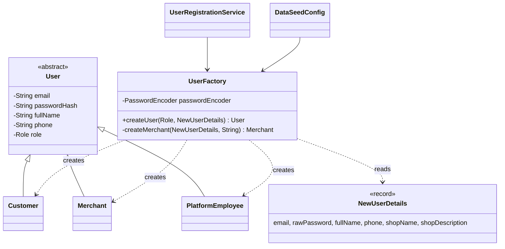

# Module 5 — User & Stakeholder Management: **Factory Pattern**

> **Category:** Creational · **Lecture:** Part II, slides 25–36 (*Transport Management / Vehicle* example)
> **Package:** `src/main/java/com/sliit/se2030/mall/user/factory/`
> **Presented by:** ______________________

---

## 1. What the lecture says

**What is Factory? (slides 26, 28)**

- A **creational** design pattern.
- **Defines an interface for creating objects.**
- **The factory decides which class to instantiate.**
- **Client code depends only on the factory + interface, not on concrete classes.**

**Why use it? (slide 27)** Hides object-creation details · reduces tight coupling ·
easy to add new product types (Open/Closed) · **centralises object creation
logic** · cleaner client code.

**The Vehicle example (slides 29–33):** a rental company offers a Car, Bike or
Truck.

1. Define a common interface — `Vehicle` with `drive()`.
2. Create concrete classes — `Car`, `Bike`, `Truck`.
3. Create a factory class — given a type, it returns the right `Vehicle`.
4. Use the factory in client code — the client never writes `new Car()`.

---

## 2. The problem in our system

The system has **three kinds of user**, all stored in one `users` table
(single-table inheritance):

```text
              User (abstract)
         ┌──────────┼────────────────┐
     Customer    Merchant     PlatformEmployee
```

Creating any of them needs the same setup — **hash the password**, set name and
phone — plus role-specific setup (a merchant needs a shop name and description,
and starts as `PENDING` approval).

Users are created in **several places**:

- `UserRegistrationService.registerCustomer()` — customer sign-up form
- `UserRegistrationService.registerMerchant()` — shop sign-up form
- `DataSeedConfig` — creates the admin employee, sample customers and sample merchants at startup

**Without the pattern**, each of those places calls `new Customer(...)`,
`new Merchant(...)`, `new PlatformEmployee(...)` directly and repeats
`passwordEncoder.encode(...)`. Forgetting to hash in one place would store a
plain-text password; adding a fourth role would mean finding every `new`.

---

## 3. Role mapping — lecture → our code

| Lecture role | Vehicle example | Our class |
|---|---|---|
| **Common interface / supertype** | `Vehicle` | `User` (abstract class) |
| **Concrete products** | `Car`, `Bike`, `Truck` | `Customer`, `Merchant`, `PlatformEmployee` |
| **Type parameter** | `"car"`, `"bike"` | `Role` enum: `CUSTOMER`, `MERCHANT`, `PLATFORM_EMPLOYEE` |
| **Factory** | `VehicleFactory` | `UserFactory` — `createUser(Role, NewUserDetails)` |
| (input data) | | `NewUserDetails` record — email, raw password, name, phone, shop name, shop description |
| **Clients** | `Main` | `UserRegistrationService`, `DataSeedConfig` |



---

## 4. Code walkthrough

### 4.1 The factory

```java
@Component
public class UserFactory {

    private final PasswordEncoder passwordEncoder;

    public UserFactory(PasswordEncoder passwordEncoder) { this.passwordEncoder = passwordEncoder; }

    public User createUser(Role role, NewUserDetails details) {
        String passwordHash = passwordEncoder.encode(details.rawPassword());   // shared setup
        User user = switch (role) {
            case CUSTOMER          -> new Customer(details.email(), passwordHash, details.fullName());
            case MERCHANT          -> createMerchant(details, passwordHash);
            case PLATFORM_EMPLOYEE -> new PlatformEmployee(details.email(), passwordHash, details.fullName());
        };
        user.setPhone(details.phone());                                       // shared setup
        return user;
    }

    // A new shop starts as VerificationStatus.PENDING until an employee approves it.
    private Merchant createMerchant(NewUserDetails details, String passwordHash) {
        if (details.shopName() == null || details.shopName().isBlank()) {
            throw new BusinessRuleViolationException("A shop name is required.");
        }
        Merchant merchant = new Merchant(details.email(), passwordHash, details.fullName(), details.shopName());
        merchant.setShopDescription(details.shopDescription());
        return merchant;
    }
}
```

Explain three things:
1. **Return type is `User`** (the supertype) — like the lecture's factory returning `Vehicle`.
2. **The `switch` on `Role` is the only place** that knows which subclass goes with which role.
3. **Creation details are hidden**: password hashing, phone, merchant shop details and the shop-name check all live here.

The factory only **builds** the object. Saving it to the database is the
caller's job — so the same factory works for registration and for seeding.

### 4.2 Input — `NewUserDetails`

```java
public record NewUserDetails(String email, String rawPassword, String fullName, String phone,
                             String shopName, String shopDescription) {
    public static NewUserDetails of(String email, String rawPassword, String fullName) { ... }
}
```

The two registration forms (`CustomerRegistrationForm`, `MerchantRegistrationForm`)
have different fields; this record is the single shape the factory accepts.

### 4.3 Client 1 — registration

```java
public Customer registerCustomer(CustomerRegistrationForm form) {
    assertEmailAvailable(form.getEmail());
    NewUserDetails details = new NewUserDetails(
            form.getEmail(), form.getPassword(), form.getFullName(), form.getPhone(), null, null);
    Customer customer = (Customer) userFactory.createUser(Role.CUSTOMER, details);
    return customerRepository.save(customer);
}
```

`registerMerchant()` is the same with `Role.MERCHANT` and the shop fields.
The cast is safe because the factory always returns a `Customer` for `CUSTOMER`.

### 4.4 Client 2 — startup data seeding (`DataSeedConfig`)

```java
PlatformEmployee employee = (PlatformEmployee) userFactory.createUser(Role.PLATFORM_EMPLOYEE,
        NewUserDetails.of(SEED_EMAIL, SEED_PASSWORD, "Platform Admin"));
...
Customer customer = (Customer) userFactory.createUser(Role.CUSTOMER,
        new NewUserDetails(email, repeat(n, 6), "cus" + n, repeat(n, 4), null, null));
...
merchant = (Merchant) userFactory.createUser(Role.MERCHANT,
        new NewUserDetails(email, repeat(n, 6), "merc" + n, null, shop.shopName(), null));
```

So **all three roles** are created through the factory when the app starts.

---

## 5. Runtime flow — a new shop registers

1. Visitor fills `/register/merchant` → `AuthController.registerMerchant()`.
2. `UserRegistrationService.registerMerchant()` checks the email is free.
3. Builds `NewUserDetails` from the form → `userFactory.createUser(Role.MERCHANT, details)`.
4. Factory hashes the password, checks the shop name, creates a `Merchant` (status `PENDING`).
5. Service saves it. The merchant can log in but stays restricted until an employee approves it.

---

## 6. How to demo it

1. Open `/register/customer`, create a customer → log in with it. *(Factory → `Customer`.)*
2. Open `/register/merchant`, create a shop → log in as the employee
   (`admin@mall.local` / `admin123`) → the new shop is in the **pending shops** list (`/employee/merchants/pending`).
   *(Factory → `Merchant`, status `PENDING`.)*
3. Show in MySQL that the password is hashed and the row type differs:
   ```sql
   SELECT email, user_type, role, LEFT(password_hash, 7) AS hash_start FROM users ORDER BY id DESC LIMIT 3;
   ```
   → `user_type` `CUSTOMER` / `MERCHANT`, hash starts with `$2a$` (BCrypt), never the typed password.
4. Mention seeding: the admin, `cus2…` and `merc1…` accounts were made by the same factory at startup.
5. Show `UserFactoryTest`: each role gives its own class with a hashed password;
   a new merchant is `PENDING`; a merchant without a shop name is rejected.

---

## 7. Consequences (slides 35–36, applied to us)

**Advantages**
- *Hides object creation details.* → Callers never call `passwordEncoder.encode()` or the constructors.
- *Centralises creation logic.* → One place guarantees every account has a hashed password.
- *Loose coupling.* → `DataSeedConfig` no longer needs a `PasswordEncoder` at all.
- *Easy to extend.* → A new role is one subclass + one `case`.

**Disadvantages**
- *Extra classes.* → `UserFactory` + `NewUserDetails`.
- *Slightly more complex.* → Callers cast the result back (`(Customer) …`).
- *"Factory explosion" if overused.* → We use one factory for one hierarchy, not one per class.

---

## 8. Explaining it yourself — walkthrough script (no questions asked)

Use this if the examiner just says *"show us your design pattern"*. About 3 minutes.
**Do** = what to have on screen. **Say** = what to explain.

| # | Do | Say |
|---|---|---|
| 1 | Open `user/entity/` showing `User`, `Customer`, `Merchant`, `PlatformEmployee` | "My module manages users. We have three user types, all subclasses of `User`. I used the **Factory pattern**, a **creational** pattern, to create them." |
| 2 | Open `UserRegistrationService` — point at `registerCustomer` | "Before, every place that created a user called `new Customer(...)` and hashed the password itself. Accounts are created in registration *and* in startup seeding, so that logic was repeated. That's the problem Factory solves: centralising object creation." |
| 3 | Open `UserFactory.createUser()` | "This is the factory. I give it a `Role` and the details, and it decides which class to create — like the lecture's `VehicleFactory` returning a `Car`, `Bike` or `Truck`. It returns the supertype `User`, so callers depend only on the factory and the supertype." |
| 4 | Point at `passwordEncoder.encode(...)` and `createMerchant` | "It also hides creation details: every account gets a hashed password here, and a merchant is checked for a shop name and starts as `PENDING`. No caller can forget these steps." |
| 5 | Point back at `registerCustomer` and at `DataSeedConfig` | "The clients now just ask the factory. The same factory creates the admin, sample customers and sample shops at startup." |
| 6 | Browser: register a merchant at `/register/merchant`; log in as admin and show it at `/employee/merchants/pending` | "Here it's running: the factory created a `Merchant`, and it's waiting for approval." |
| 7 | Run `UserFactoryTest` (green) | "These tests check each role produces the right class, the password is hashed, and a merchant needs a shop name." |
| 8 | — | "The benefit is Open/Closed: a new role means one subclass and one `case` here, nothing else. The cost from the slides is an extra class and a slightly more complex design." |

---

## 9. Viva questions & answers

**Q: What does the factory decide?**
A: Which `User` subclass to instantiate for a given `Role`, plus the setup that
goes with it (hashing, phone, merchant shop details).

**Q: Why return `User` and not `Customer`?**
A: So the factory has one method for every role and callers depend on the
supertype — the same as the lecture's factory returning `Vehicle`. Callers that
need the specific type cast it; that's safe because the role decides the class.

**Q: How would you add a new role, e.g. `DeliveryAgent`?**
A: Add `DELIVERY_AGENT` to `Role`, create `DeliveryAgent extends User`, and add
one `case` to `createUser()`. Because Java's `switch` expression must cover all
enum values, the compiler forces you to update the factory.

**Q: Why doesn't the factory save the user?**
A: Single Responsibility: the factory *creates*, repositories *store*. That lets
registration and seeding both reuse it, and keeps it easy to unit-test without a database.

**Q: Isn't this just a constructor with extra steps?**
A: A constructor creates one known class. The factory *chooses* the class from
a role and applies shared rules (password hashing) once for all of them; the
callers no longer know about the concrete classes.

**Q: Where is the Factory in the Payment module, and how is it different?**
A: `PaymentStrategyFactory` creates payment *strategies* (behaviour objects).
`UserFactory` creates *entities* (data objects). Same pattern, different products.
