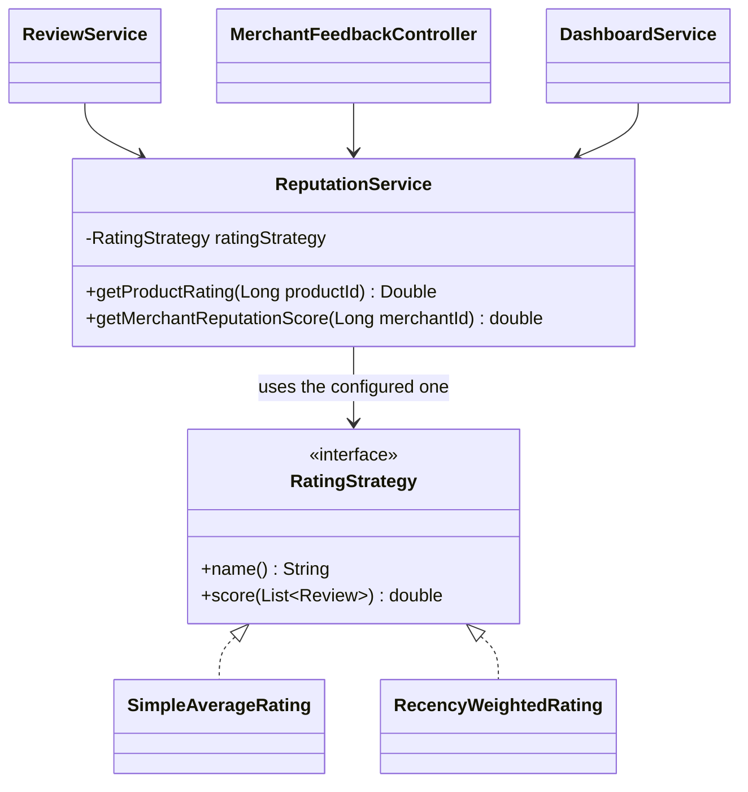

# Module 6 — Product Feedback & Reputation: **Strategy Pattern (rating rule)**

> **Category:** Behavioral · **Lecture:** Part II, slides 2–24
> **Package:** `src/main/java/com/sliit/se2030/mall/feedback/rating/`
> **Presented by:** ______________________

---

## 1. What the lecture says

**Definition (slide 3):**

> "Defines a family of algorithms, encapsulates each one, and makes them
> interchangeable. Allows algorithms to vary independently from the clients
> that use them."

| Component (slides 15–20) | Responsibility |
|---|---|
| **Context** | The class the client uses; it doesn't implement the algorithm itself but keeps a reference to a Strategy and uses it |
| **Strategy** | The common interface every algorithm follows; declares the method, no implementation |
| **Concrete Strategies** | The real classes, each a different version of the algorithm |
| **Client** | Code that selects which strategy is applied |

**Advantages (slide 23):** no long if–else · easy to extend (Open/Closed) ·
runtime flexibility · Single Responsibility · reusable.

---

## 2. The problem in our system

Reviews (1–5 stars, verified purchases only) are turned into **one score** in
three places:

1. A **product's rating** on its page (`/catalog/{id}`).
2. A **shop's reputation score** on the merchant feedback dashboard (`/merchant/feedback`) and merchant home.
3. The **low-rating flag**: a product whose score drops below **2.5** is flagged
   for the mall team (`/employee/flagged-products`).

There is more than one fair way to combine ratings:

- **Simple average** — every review counts the same.
- **Recency-weighted** — newer reviews count more, so a shop that has improved
  isn't stuck with old complaints.

**Without the pattern**, the formula was hard-coded as an SQL `AVG(...)` query in
two places, and offering the second rule would mean `if (mode == ...)` in
every place a score is computed. Changing the rule would touch the product
page, the shop dashboard *and* the flagging logic.

---

## 3. Role mapping — lecture → our code

| Lecture role | Our class |
|---|---|
| **Strategy** interface | `RatingStrategy` — `String name()`, `double score(List<Review> reviews)` |
| **Concrete Strategies** | `SimpleAverageRating` (`"simple"`), `RecencyWeightedRating` (`"recency-weighted"`) |
| **Context** | `ReputationService` — `getProductRating()`, `getMerchantReputationScore()` |
| **Client** (selects) | The configuration: `mall.rating.strategy` in `application.properties` |
| Users of the context | `ReviewService` (product page + low-rating flag), `MerchantFeedbackController`, `DashboardService` |



---

## 4. Code walkthrough

### 4.1 Strategy interface

```java
public interface RatingStrategy {
    String name();                         // the value used in mall.rating.strategy
    double score(List<Review> reviews);    // only called with at least one review
}
```

### 4.2 Concrete strategy 1 — simple average

```java
@Component
public class SimpleAverageRating implements RatingStrategy {
    public String name() { return "simple"; }

    public double score(List<Review> reviews) {
        return reviews.stream().mapToInt(Review::getRating).average().orElse(0.0);
    }
}
```

### 4.3 Concrete strategy 2 — recency-weighted

```java
@Component
public class RecencyWeightedRating implements RatingStrategy {

    private static final double HALF_LIFE_DAYS = 180;

    public String name() { return "recency-weighted"; }

    public double score(List<Review> reviews) {
        Instant now = Instant.now();
        double weightedSum = 0, totalWeight = 0;
        for (Review review : reviews) {
            double ageDays = Math.max(0, Duration.between(review.getCreatedAt(), now).toHours() / 24.0);
            double weight = Math.pow(0.5, ageDays / HALF_LIFE_DAYS);   // halves every 180 days
            weightedSum += weight * review.getRating();
            totalWeight += weight;
        }
        return totalWeight == 0 ? 0.0 : weightedSum / totalWeight;
    }
}
```

**Worked example** (the one in `RatingStrategyTest`) — a 5★ review today and a 1★ review 360 days ago:

| | Simple average | Recency-weighted |
|---|---|---|
| Weights | 1 and 1 | 1 (today) and 0.25 (two half-lives old) |
| Score | (5 + 1) / 2 = **3.0** | (5×1 + 1×0.25) / 1.25 = **4.2** |

Same reviews, same interface, different algorithm → different result.

### 4.4 The context — `ReputationService`

```java
@Service
public class ReputationService {

    private final ReviewRepository reviewRepository;
    private final RatingStrategy ratingStrategy;

    // Spring passes in every RatingStrategy bean; we keep the configured one.
    public ReputationService(ReviewRepository reviewRepository, List<RatingStrategy> strategies,
                             @Value("${mall.rating.strategy:simple}") String strategyName) {
        this.reviewRepository = reviewRepository;
        this.ratingStrategy = strategies.stream()
                .filter(strategy -> strategy.name().equals(strategyName))
                .findFirst()
                .orElseThrow(() -> new IllegalStateException("Unknown mall.rating.strategy: " + strategyName));
    }

    public double getMerchantReputationScore(Long merchantId) {
        List<Review> reviews = reviewRepository.findByProduct_Merchant_Id(merchantId);
        return reviews.isEmpty() ? 0.0 : ratingStrategy.score(reviews);
    }

    public Double getProductRating(Long productId) {
        List<Review> reviews = reviewRepository.findByProduct_Id(productId);
        return reviews.isEmpty() ? null : ratingStrategy.score(reviews);
    }
}
```

- Holds **a reference to one strategy**, exactly as the lecture's Context does.
- The "no reviews yet" case is handled *once* here, so the strategies stay simple.
- A typo in the property name **stops the app at startup** with a clear message,
  rather than failing later on the first review.

### 4.5 The same strategy drives all three uses

```java
// ReviewService
public Double getAverageRating(Long productId) {
    return reputationService.getProductRating(productId);           // product page
}

private void recomputeFlagForProduct(Product product) {             // after every new review
    Double average = reputationService.getProductRating(product.getId());
    product.setFlaggedForReview(average != null && average < LOW_RATING_THRESHOLD);   // 2.5
}
```

`MerchantFeedbackController` and `DashboardService` call
`getMerchantReputationScore()`. So switching the strategy changes the product
page, the shop's reputation **and** which products get flagged — consistently.

### 4.6 Choosing the strategy (`application.properties`)

```properties
# simple = plain average; recency-weighted = newer reviews count for more.
mall.rating.strategy=simple
```

---

## 5. Runtime flow — a customer submits a review

1. Customer reviews a delivered item → `ReviewService.submitReview()` saves the review.
2. `recomputeFlagForProduct()` → `ReputationService.getProductRating(productId)`.
3. The context loads that product's reviews and calls `ratingStrategy.score(reviews)` on the configured strategy.
4. If the score is below 2.5 the product is flagged; otherwise any earlier flag is cleared.
5. The product page and the shop's dashboard show scores from the same strategy.

---

## 6. How to demo it

Prepare beforehand: a product with a few reviews. Reviews need a **delivered**
order item: customer orders → merchant marks the item *Delivered* at
`/merchant/orders` → customer clicks **Write a review** on the order.

1. Open the product page `/catalog/{id}` — note the star rating and the "x out of 5".
2. Log in as the shop's merchant → `/merchant/feedback` — note the reputation score.
3. In `application.properties` set `mall.rating.strategy=recency-weighted`, restart.
   - With reviews of the same age, the score stays about the same (equal weights) — say so.
   - The difference shows when reviews are of different ages; show it with the test instead.
4. Run `RatingStrategyTest` — the worked example above: **3.0** vs **4.2** for the same two reviews.
5. Show the flag: several 1–2★ reviews on one product → it appears in `/employee/flagged-products` (as admin).
6. Optional: set `mall.rating.strategy=wrong` and start the app → it refuses to start with *"Unknown mall.rating.strategy: wrong"*.

---

## 7. Consequences (slides 23–24, applied to us)

**Advantages**
- *Eliminates if–else.* → No `if (mode == …)` in the product page, dashboard or flag logic.
- *Easy to extend.* → A new rule is one `@Component` class; Spring finds it automatically.
- *Runtime flexibility.* → The rule is switched in configuration, no code change.
- *Single Responsibility.* → `ReputationService` fetches reviews; strategies only do maths.
- *Consistency.* → One strategy object serves all three uses.

**Disadvantages**
- *More classes.* → An interface + two classes instead of one SQL `AVG`.
- *Client awareness needed.* → Someone must choose the strategy (the property).
- *Performance.* → We now load the review rows and compute in Java instead of letting
  the database average them. Fine at this project's size; for a very large mall
  you'd cache the score or compute it in SQL.

---

## 8. Explaining it yourself — walkthrough script (no questions asked)

Use this if the examiner just says *"show us your design pattern"*. About 3 minutes.

| # | Do | Say |
|---|---|---|
| 1 | Open a product page with reviews | "My module turns customer reviews into ratings: the product's rating, the shop's reputation, and a flag when a product's rating falls below 2.5. I used the **Strategy pattern**, a **behavioral** pattern." |
| 2 | — | "There's more than one fair way to combine ratings — a plain average, or weighting newer reviews more. Without Strategy, every place that shows a score would need an `if` for each rule. That's the 'long if–else' problem from the lecture." |
| 3 | Open `RatingStrategy` | "This is the Strategy interface. Every rule has a `score()` method that takes the reviews and returns one number." |
| 4 | Open `SimpleAverageRating`, then `RecencyWeightedRating` | "These are the concrete strategies: one is a simple average; the other halves a review's weight every 180 days, so recent reviews count more." |
| 5 | Open `ReputationService` | "This is the Context. It holds one `RatingStrategy`, chosen from configuration, and every score in the system goes through it. It doesn't know which formula it's using." |
| 6 | Open `application.properties` → `mall.rating.strategy` | "The client choice is this setting. Switching rule is a one-line change — no code change." |
| 7 | Point at `ReviewService.recomputeFlagForProduct()` | "The low-rating flag uses the same strategy, so the product page, the shop score and the flag always agree." |
| 8 | Run `RatingStrategyTest` | "Same two reviews: simple average gives 3.0, recency-weighted gives 4.2. Same interface, interchangeable algorithms." |
| 9 | — | "Benefit: a new rule, e.g. 'ignore products with fewer than 3 reviews', is one new class. Cost from the slides: more classes, and someone must pick the strategy." |

---

## 9. Viva questions & answers

**Q: Which class is the Context?**
A: `ReputationService`. It keeps a reference to one `RatingStrategy` and uses it
for every product and shop score.

**Q: Who chooses the strategy?**
A: The configuration property `mall.rating.strategy`. Spring gives
`ReputationService` all `RatingStrategy` beans and it keeps the one whose
`name()` matches.

**Q: How do you add a new rule, e.g. "Bayesian average" or "minimum 3 reviews"?**
A: Write a new `@Component` class implementing `RatingStrategy` with its own
`name()`, then set `mall.rating.strategy` to that name. No existing class changes.

**Q: Why not just keep the SQL `AVG()` query?**
A: `AVG()` can only express the simple average. Moving the formula into
strategy classes lets the rule change without touching the services, and the
formulas are unit-tested without a database.

**Q: Can the strategy change while the app is running?**
A: In our version it's chosen at startup from configuration. The structure
supports runtime switching — the context would just need a setter, or take the
strategy as a parameter like the catalog sort does.

**Q: How is this different from the Catalog module's Strategy?**
A: Same pattern, different family and chooser: Catalog's strategies *order a
product list* and the **shopper** picks per request; Feedback's strategies
*compute a score* and the **configuration** picks once for the whole system.

**Q: What does the recency weight formula mean?**
A: `weight = 0.5 ^ (ageDays / 180)` — a review's influence halves every 180 days:
today = 1, 6 months = 0.5, 1 year = 0.25. The score is the weighted average.
